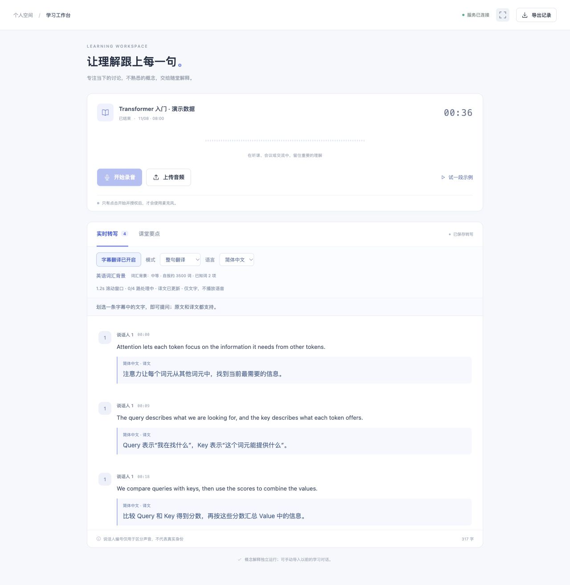
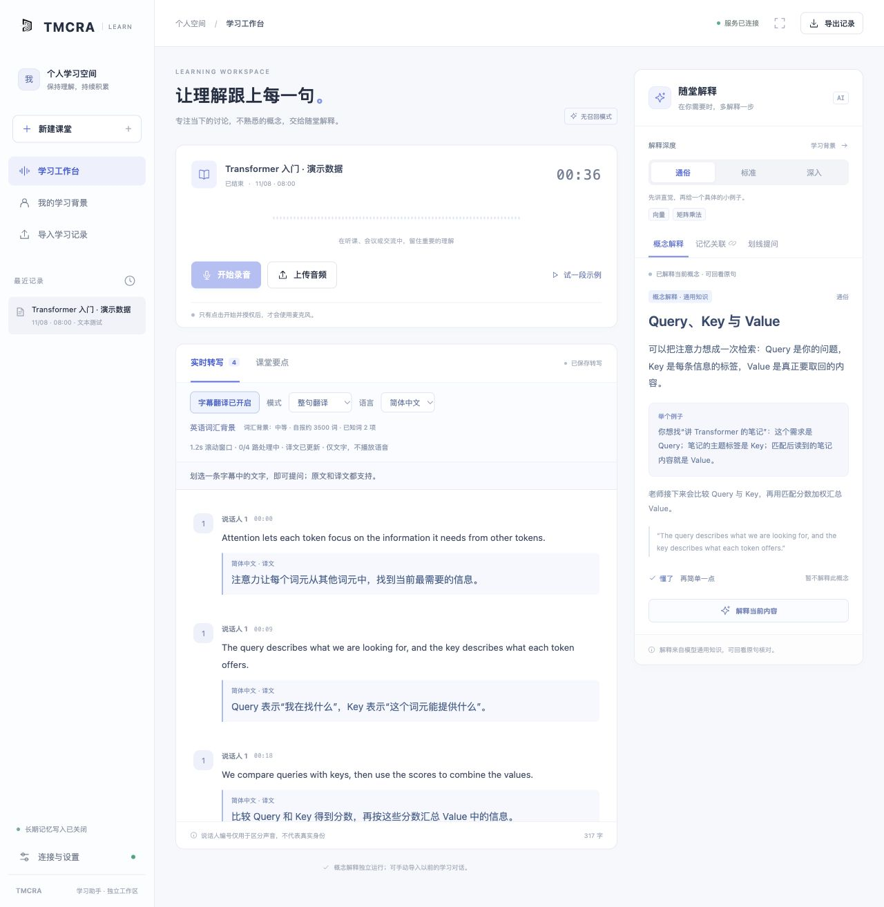
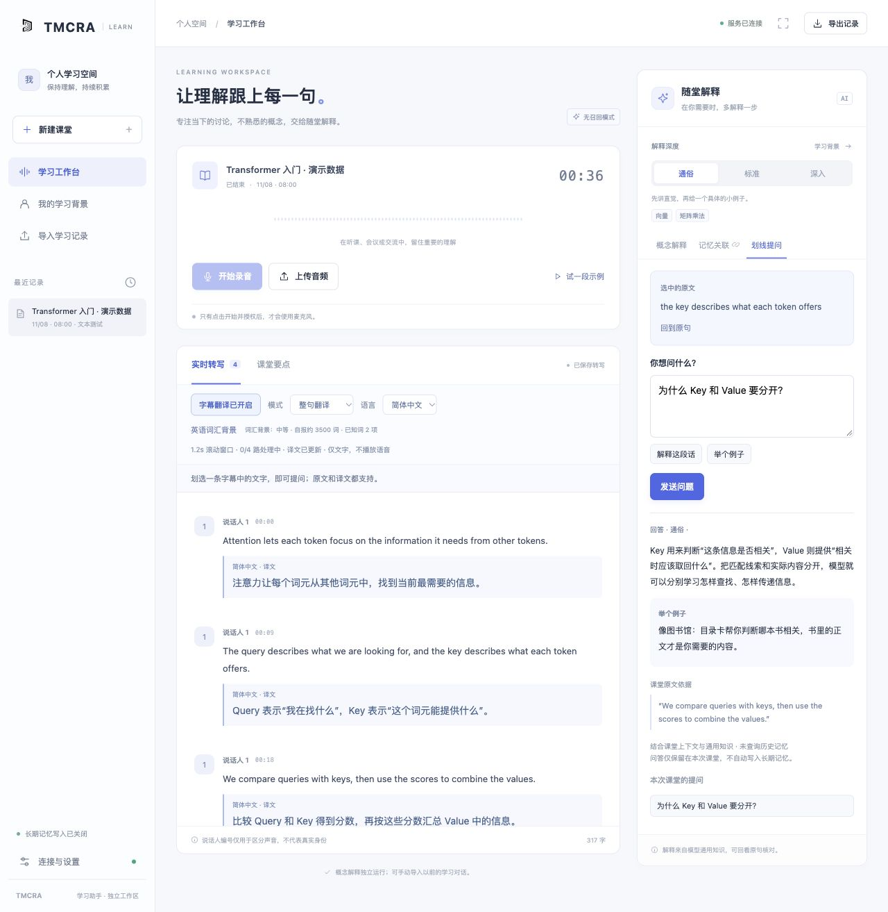
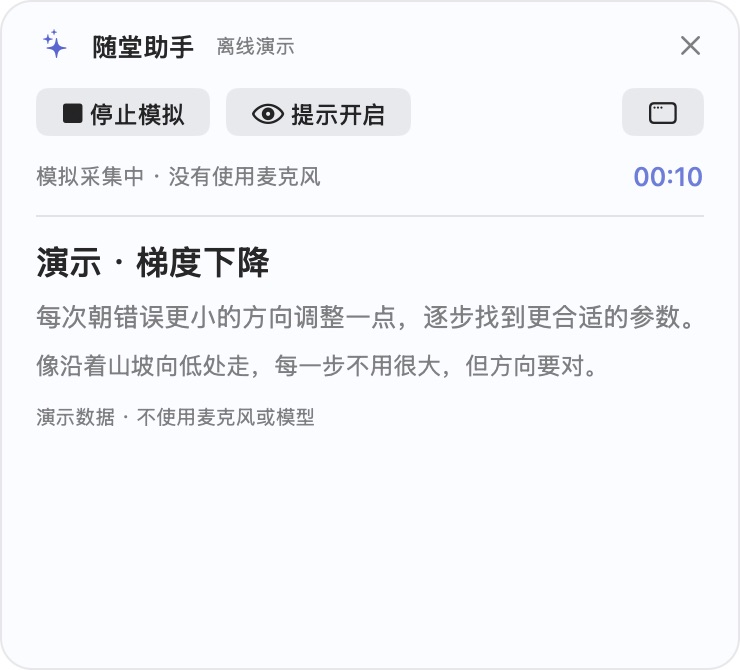

# TMCRA Learning Assistant · 随堂学习助手

把会议或课堂中的声音变成**字幕、概念解释，以及可选的学习记忆关联**。

录音由用户手动开始和结束；上传断线时先保存本地缓存，再按服务器确认的字节位置补传。它是独立应用，通过 API 连接 [TMCRA 记忆核心](https://github.com/reshuibuduo/tmcra)，不是 TMCRA 本体，也不包含模型权重。

> **v0.1.0 / early release**：适合个人、单用户工作区。默认不连接、不写入长期记忆；核心流程不需要 GPU。云端 ASR 与推理 API 的费用由使用者承担。

## 能做什么

- **实时转写**：豆包语音流式 ASR，匿名声音分组；保留原始 PCM 和带出处的定稿字幕。
- **字幕辅助**：整句翻译、整句加生词、仅生词提示；按英语词汇背景调节解释。
- **随堂解释**：主动解释新概念，无须命中历史记忆；支持学习背景提示词复制、粘贴预览后确认导入。
- **划线提问**：选中原文或译文，流式显示回答，不等待整段完成。
- **滚动窗口**：翻译与辅助学习合并短窗口、按需触发；不是每句话都发独立请求，也不是一条永不结束的模型调用。
- **音频恢复**：IndexedDB 本地提交、字节偏移上传、落盘确认、重复片段去重、断线重连。
- **可选记忆**：显式开启后，可导入学习对话资料并连接 TMCRA 的检索与写入接口。
- **macOS 悬浮窗**：主窗口最小化后保留手动录音控制和提示展示；另附离线交互演示。

## 界面预览

以下截图来自实际 Web 界面和 macOS 悬浮窗，使用独立演示数据；不包含真实会议、个人学习记录或 API 密钥。截图用于展示交互，不代表实时模型输出、延迟或识别准确率测试。

### 实时字幕

原文与译文对照显示，保留说话人编号和时间位置；也支持仅提示生词。图中展示专注模式下的演示转写回看。



### 主动解释新概念

围绕正在讲解的概念给出直觉、例子和课堂原句，不需要先命中历史记忆。



### 划线提问

选中原文或译文后提问，结合上下文解释，并保留原句出处。回答支持流式显示；图中展示已完成的演示回答。



### macOS 悬浮窗

主窗口收起后，仍可在悬浮窗手动开始／停止采集、开关提示和查看解释。图中为内置离线演示，不使用麦克风或模型。



## 五分钟启动

准备 **Python 3.12**。前端不需要 npm 构建；Node 22 只用于测试。当前音频适配器依赖 `audioop`，暂不支持 Python 3.13+。

```bash
git clone https://github.com/reshuibuduo/tmcra-learning-assistant.git
cd tmcra-learning-assistant
python3.12 -m venv .venv
source .venv/bin/activate
python -m pip install -r workbench/requirements.lock.txt
cp .env.example .env
```

在 `.env` 中填写：

```dotenv
VOLC_API_KEY=your_speech_service_key
DEEPSEEK_API_KEY=your_deepseek_key
```

`VOLC_API_KEY` 是**豆包语音服务**凭证，不是火山方舟通用 Key；需开通对应流式识别资源。默认资源为 `volc.seedasr.sauc.duration`，如账号使用其他资源，请修改生成的 `runtime/config.json`。

```bash
python scripts/workspace.py init --env-file .env
python scripts/workspace.py serve
```

在另一个已激活虚拟环境的终端运行：

```bash
python scripts/workspace.py login
```

打开输出的 90 秒一次性登录链接，进入 `http://127.0.0.1:18782/`。**页面加载不启动麦克风**：点击“开始录音”并授权才采集，点击“结束采集”才收尾。

`init` 将密钥写到本地 `runtime/secrets/`，权限为 `0600`；不会打印 provider key。重复初始化不会清空录音、重置访问令牌或覆盖已有配置。不要提交 `.env`、`runtime/` 或真实录音。

### OpenAI 作为可选推理后端

首次初始化时提供 `VOLC_API_KEY`、`OPENAI_API_KEY`，并使用：

```bash
python scripts/workspace.py init --env-file .env --provider openai
```

模型名称在 `runtime/config.json` 中配置。初始化已有工作区会沿用原 provider，不自动切换；更换时需先更新该配置并补齐对应凭证。ASR 仍由豆包语音负责。

## 断线时发生什么

```text
用户点击开始 → 麦克风 PCM → IndexedDB 提交 → 带偏移上传
                                  ↑             ↓
                              未确认片段保留 ← 服务端 fsync 后 ACK

服务器 PCM → 可恢复 ASR → 定稿字幕 → 滚动窗口 → 翻译 / 解释 / 可选召回
用户点击结束 → 先停止麦克风 → 补传缓存 → 完成转写收尾
```

- 断网不会主动停止仍在工作的麦克风；界面显示待上传音频。
- 页面刷新后不会自动开麦。可点击“补传并保存缓存音频”只上传缓存，或手动“继续这场录音”。
- ASR 连接失败与录音存储分离；识别按检查点恢复，原始音频不因识别失败而删除。
- 录音时需保留标签页。浏览器被关闭、系统休眠或音频设备断开后，本项目不承诺继续采集；从未采集到的声音不属于可恢复数据。
- 本地待上传缓存上限 512 MiB；存储失败会提示暂停，而不是假报继续上传。长时间离线请关注提示。
- 声音编号是**单次识别连接内的匿名聚类**，不是身份识别；换连接后编号可能变化。

更多：[架构与数据流](docs/architecture.md) · [部署与恢复](docs/deployment.md) · [TMCRA 接入](docs/memory.md) · [验收边界](docs/verification.md)

## macOS 悬浮窗（可选）

需要 Xcode Command Line Tools：

```bash
bash desktop/build.sh
open "dist/TMCRA 学习悬浮窗.app"
```

在应用中连接本机工作台；使用与浏览器相同的一次性登录机制。构建默认使用当前 SDK 和本机架构，也可设置 `TMCRA_SDKROOT`、`TMCRA_ARCH`。产物为本地 ad-hoc 签名，不是已公证的安装包。

## 测试

```bash
python scripts/test_backend.py
node --test tests/*.test.mjs desktop/Tests/*.test.mjs
python scripts/check_release.py
python scripts/smoke_test.py
```

以上测试不需要真实 API key，不使用麦克风、不调用付费模型。真实 ASR、麦克风和长会话需另做验收，不能由单元测试代替。GitHub Actions 运行 Python / Node 回归与 macOS 构建。

## 项目结构

```text
workbench/meeting/       FastAPI、ASR、推理、记忆连接和静态前端
workbench/ops/           通用 DeepSeek 配置，不含私人服务器脚本
desktop/                macOS 悬浮窗源码及测试
scripts/                初始化、启动、登录、离线测试、发布扫描
docs/                   架构、部署、记忆接入和验收说明
runtime/                本地生成的私有数据，Git 忽略
```

## License

[Apache-2.0](LICENSE)。保留 TMCRA 相关素材的原许可证，详见 [NOTICE](NOTICE)。此仓库不分发 TMCRA 模型权重、第三方 API 凭证或真实会议数据。
